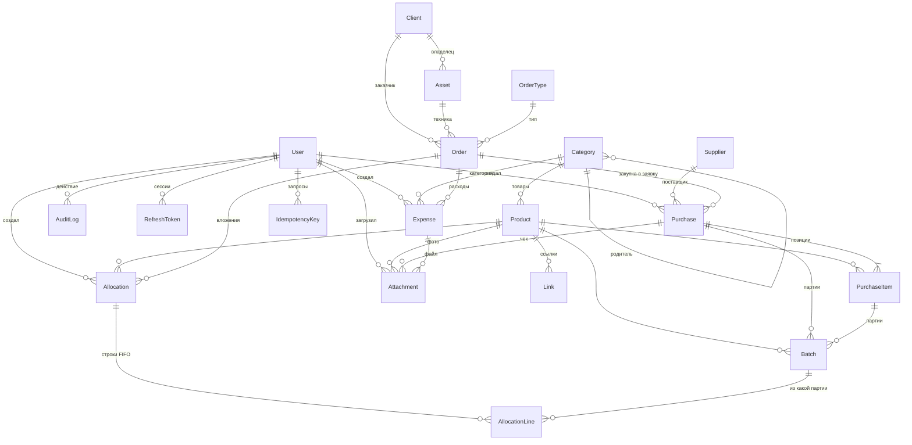

# База данных: описание схемы

Документ описывает схему `server/prisma/schema.prisma` (Prisma 7, PostgreSQL). Он объясняет, зачем нужна каждая таблица, как таблицы связаны и по каким правилам живут данные. Источник требований: `docs/02-spec.md`. Правила, которые сервер обязан гарантировать: `docs/03-backend-plan.md`, раздел 2.

Состояние на 2026-11-22: схема написана и проходит `prisma validate`, миграции `init` ещё нет.

## Содержание

1. [Общая картина](#1-общая-картина)
2. [Соглашения схемы](#2-соглашения-схемы)
3. [Диаграмма связей](#3-диаграмма-связей)
4. [Перечисления (enum)](#4-перечисления-enum)
5. [Таблицы](#5-таблицы)
6. [Как это работает вместе](#6-как-это-работает-вместе)
7. [Правила и инварианты](#7-правила-и-инварианты)
8. [Ограничения, которые вписываются в миграцию вручную](#8-ограничения-которые-вписываются-в-миграцию-вручную)
9. [Индексы](#9-индексы)
10. [Политика удаления данных](#10-политика-удаления-данных)
11. [Что отложено или открыто](#11-что-отложено-или-открыто)

---

## 1. Общая картина

MLT Облік учитывает, сколько стоил каждый ремонт. Для этого в базе три слоя данных.

| Слой | Что хранит | Откуда данные |
|---|---|---|
| Данные RO App | Заявки, клиенты, техника, типы и статусы заявок | Приходят из RO App, система их только читает |
| Склад и деньги | Товары, закупки, партии, вложения в заявки | Создаются в MLT Облік |
| Служебные | Пользователи, журнал, настройки, файлы, токены | Создаются в MLT Облік |

Главная цепочка выглядит так:

```
Закупка  ->  Партия на складе  ->  Вложение в заявку  ->  Себестоимость заявки
(купили)     (лежит, есть цена)    (списали по FIFO)      (сумма вложений)
```

- **Закупка** создаёт партии. Это не расход, а поступление на склад.
- **Вложение** списывает материал из партий и фиксирует цену. Вот это и есть расход на ремонт.
- Суммы закупок и вложений никогда не складываются: иначе одна и та же запчасть будет посчитана дважды.

## 2. Соглашения схемы

| Тема | Правило |
|---|---|
| Идентификаторы | Строки, uuid (`@id @default(uuid())`) |
| Деньги | Целые копейки, поля называются `*Kop` (`unitPriceKop`, `totalKop`), тип `Int`. Не `Float` и не `Decimal` |
| Количество | `Decimal(12,2)`: два знака после запятой, дробные литры и килограммы поддерживаются |
| Время | `DateTime @db.Timestamptz(3)`: время хранится в UTC, миллисекунды |
| `createdAt` / `updatedAt` | `createdAt` ставит БД, `updatedAt` обновляет Prisma (`@updatedAt`) |
| Идентификатор из RO App | Поле `roAppId`, всегда с `@unique`. Повторная синхронизация обновляет запись, а не создаёт дубль |
| Enum | Значения латиницей в верхнем регистре. Украинские подписи подставляет серверный маппер |
| Названия на уровне БД | Prisma создаёт таблицы и колонки с теми же именами, что в схеме (`"Purchase"`, `"qtyRemaining"`) |

Пример денег: цена 125,50 грн хранится как `12550`. Сумма вложения `qty × unitPriceKop` округляется до целой копейки на каждой строке списания.

## 3. Диаграмма связей



Таблицы без связей: `Counter`, `StatusMapping`, `SyncLog`, `Setting`.

## 4. Перечисления (enum)

| Enum | Значения | Смысл |
|---|---|---|
| `Role` | `ADMIN`, `EXECUTOR` | Роль пользователя. Остальные права выдаются индивидуально через `User.extraPermissions` |
| `CategoryKind` | `PRODUCT`, `SERVICE` | Тип категории. `SERVICE` пока задел |
| `Unit` | `PCS`, `L`, `KG`, `M` | Единица измерения товара: шт, л, кг, м |
| `PurchaseDestination` | `WAREHOUSE`, `ORDER` | Куда идёт закупка: на склад или напрямую в заявку |
| `LocalStatus` | `IN_QUEUE`, `IN_WORK`, `DONE`, `CLOSED` | Локальный статус заявки, в который маппится статус RO App |
| `AllocationKind` | `PRODUCT`, `SERVICE` | Вложение: товар со склада или услуга |
| `AllocationStatus` | `ACTIVE`, `RETURNED`, `CANCELLED` | Состояние вложения |
| `AttachmentKind` | `PRODUCT_PHOTO`, `RECEIPT`, `EXPENSE_FILE` | Для чего загружен файл |
| `SyncSource` | `WEBHOOK`, `MANUAL`, `NIGHTLY` | Что запустило синхронизацию с RO App |

Типы заявок (`OrderType`) и статусы RO App в enum не вынесены нарочно: их набор приходит из RO App и может расти.

---

## 5. Таблицы

### 5.1 Пользователи и доступ

#### `User` — пользователь системы

Сотрудники сервиса, которые заходят в MLT Облік. Самостоятельной регистрации нет, пользователей создаёт администратор.

| Поле | Тип | Описание |
|---|---|---|
| `id` | uuid | Идентификатор |
| `roAppId` | String? уникальное | Идентификатор сотрудника в RO App. Нужен, чтобы связать пользователя с менеджером или исполнителем заявки |
| `email` | String уникальное | Логин |
| `firstName`, `lastName` | String | Имя и фамилия |
| `passwordHash` | String | Хеш пароля (bcryptjs). Сам пароль не хранится |
| `role` | `Role` | `ADMIN` или `EXECUTOR`, по умолчанию `EXECUTOR` |
| `extraPermissions` | String[] | Индивидуальные права сверх роли, например `allocations.edit_closed`, `reports.view` |
| `blocked` | Boolean | Блокировка вместо удаления. Заблокированный не входит, его refresh-токены отзываются |
| `roAppName` | String? | Имя сотрудника в RO App для отображения |

Заметки:
- Пароль при создании генерирует сервер и один раз показывает администратору.
- Права проверяются только на сервере.
- Пользователь никогда не удаляется: на него ссылаются закупки, вложения и журнал.

#### `RefreshToken` — токен обновления сессии

Access JWT живёт 8 часов, refresh-токен 30 дней. Позволяет не вводить пароль каждый день и при этом отозвать сессию.

| Поле | Описание |
|---|---|
| `tokenHash` | Хеш токена. Сам токен в БД не хранится. Уникальный |
| `expiresAt` | Когда истекает |
| `revokedAt` | Когда отозван (выход, блокировка, ротация). `NULL` значит действует |
| `replacedById` | Какой токен выдан взамен. Образует цепочку ротации |
| `userId` | Владелец. Единственная связь с `onDelete: Cascade` среди пользовательских |

Токен ротируется при каждом обновлении: старый получает `revokedAt` и `replacedById`, выдаётся новый. При выходе и блокировке отзываются все токены пользователя.

#### `IdempotencyKey` — защита от двойной отправки

Клиент отправляет заголовок `Idempotency-Key`. Если запрос с тем же ключом уже обработан, сервер возвращает сохранённый ответ и не повторяет операцию. Нужно для создания закупок и вложений, где двойной клик или повтор после обрыва связи создал бы дубликат.

| Поле | Описание |
|---|---|
| `userId` + `key` | Уникальная пара. Ключ принадлежит пользователю |
| `method`, `path` | Какой запрос был |
| `requestHash` | Хеш тела запроса: тот же ключ с другим телом означает ошибку клиента |
| `responseCode`, `responseBody` | Сохранённый ответ (JSON) |
| `createdAt` | Для периодической очистки старых ключей |

### 5.2 Справочники

#### `Category` — категория товаров

Дерево категорий (родитель и дочерние).

| Поле | Описание |
|---|---|
| `name` | Название |
| `kind` | `PRODUCT` или `SERVICE`. По умолчанию `PRODUCT` |
| `parentId` | Родительская категория или `NULL` для корня. Самосвязь `CategoryTree` |
| `isActive` | Деактивация вместо удаления |

#### `Supplier` — поставщик

| Поле | Описание |
|---|---|
| `name`, `contact`, `address`, `comment` | Название, контактное лицо, адрес, заметка |
| `phone`, `email` | **Массивы**: у поставщика может быть несколько телефонов и почт |
| `isActive` | Деактивация вместо удаления. История закупок остаётся |

#### `Product` — товар (номенклатура)

Описание позиции: что это и в чём измеряется. **Остатков и цен товар не хранит**: они живут в партиях (`Batch`). Средняя цена и стоимость остатка вычисляются.

| Поле | Описание |
|---|---|
| `name` | Название, например «Карбюратор Honda Dio» |
| `categoryId` | Категория |
| `unit` | Единица измерения, по умолчанию `PCS` |
| `isActive` | Деактивация вместо удаления |

Нулевой остаток не удаляет товар: он остаётся в списке со статусом «немає в наявності».

#### `Link` — ссылка на магазин

Ссылки товара на интернет-магазины (подпись и URL). Отдельная таблица, потому что их несколько.

| Поле | Описание |
|---|---|
| `label`, `url` | Подпись и адрес |
| `productId` | Товар. `onDelete: Cascade`: ссылки не финансовые данные и удаляются вместе с товаром (товар физически не удаляется, так что это просто защита) |

### 5.3 Закупки и склад

#### `Purchase` — закупка

Документ покупки. Содержит несколько позиций (`PurchaseItem`). Сумма считается как сумма позиций и в БД не хранится.

| Поле | Описание |
|---|---|
| `number` | Номер вида `З-00001`. Уникальный. Минимум 5 цифр, после `З-99999` становится `З-100000`. Генерируется из `Counter` |
| `date` | Дата закупки |
| `docNumber` | Номер чека или накладной |
| `comment` | Комментарий |
| `destination` | `WAREHOUSE` (на склад, по умолчанию) или `ORDER` (напрямую в заявку) |
| `orderId` | Заявка, если закупка «в заявку». Для `WAREHOUSE` пусто |
| `supplierId` | Поставщик |
| `createdById` | Кто создал |
| `cancelled`, `cancelledAt`, `cancelledById` | Отмена закупки. Причина не хранится |

Правила:
- Закупка не удаляется, только отменяется.
- Закупка со страницы «Нова закупівля» всегда идёт на склад. Закупка «в заявку» создаётся только из диалога вложения внутри карточки заявки.
- Статус закупки (новая, частично распределена, полностью распределена, отменена) вычисляется из остатков партий, в БД не хранится.
- Фото чека хранится в `Attachment` с видом `RECEIPT`.

#### `PurchaseItem` — позиция закупки

Одна строка закупки: товар, количество и цена.

| Поле | Описание |
|---|---|
| `purchaseId`, `productId` | К какой закупке и какой товар |
| `qty` | Количество (`Decimal(12,2)`) |
| `unitPriceKop` | Цена за единицу в копейках |
| `note` | Заметка |

Сумма позиции = `qty × unitPriceKop`. Из каждой позиции при создании закупки возникает партия.

#### `Batch` — партия

Самая важная таблица склада. Партия это одно поступление товара с конкретной ценой. Складской остаток товара равен сумме `qtyRemaining` его партий.

| Поле | Описание |
|---|---|
| `productId` | Товар |
| `purchaseId`, `purchaseItemId` | Откуда партия. **Необязательные**: у партии-корректировки закупки нет |
| `qtyReceived` | Сколько поступило. Не меняется |
| `qtyRemaining` | Сколько осталось. Уменьшается при вложениях, увеличивается при возврате и отмене вложения |
| `unitPriceKop` | Цена партии. **Не меняется никогда** после поступления |
| `receivedAt` | Когда поступила. По этому полю идёт FIFO |
| `adjustment` | `true` для партии, созданной ручной корректировкой остатка |

Почему партии, а не просто остаток: товар одного названия поступает по разным ценам. Историческая стоимость вложений не должна пересчитываться по текущей цене.

Закупка «в заявку» создаёт партию с нулевым остатком (`qtyRemaining = 0`) и сразу вложение, то есть на склад ничего не попадает.

#### `Counter` — счётчик

Таблица ключ-значение для последовательных номеров.

| Поле | Описание |
|---|---|
| `key` | Имя счётчика, например `purchase` |
| `value` | Текущее значение |

Значение увеличивается внутри той же транзакции, что создаёт закупку. Так номера не повторяются и не пропускаются при параллельных запросах.

### 5.4 Данные RO App (только чтение)

RO App остаётся единственным источником заявок. В RO App ничего не пишется. Записи в этих таблицах создаются и обновляются синхронизацией.

#### `Client` — клиент

| Поле | Описание |
|---|---|
| `roAppId` | Идентификатор в RO App. Уникальный |
| `firstName`, `lastName` | Имя и фамилия |
| `isOrganization` | Организация или физическое лицо |
| `email`, `phone` (массив), `address` | Контакты |
| `syncedAt` | Когда последний раз обновлён из RO App |

#### `Asset` — техника

Объект ремонта (скутер, генератор и т. п.).

| Поле | Описание |
|---|---|
| `roAppId`, `uid` | Идентификатор в RO App и уникальный код техники |
| `title`, `kind`, `brand`, `model`, `color`, `state` | Описание. `kind` это тип техники для аналитики |
| `costKop` | Стоимость техники, если RO App её отдаёт |
| `ownerId` | Владелец (`Client`) |
| `syncedAt` | Время последней синхронизации |

#### `OrderType` — тип заявки

Справочник типов (например, «Выезд», «Платный», «Гарантия»). Таблица, а не enum, потому что список приходит из RO App.

| Поле | Описание |
|---|---|
| `roAppId` | Идентификатор в RO App |
| `name` | Название |

#### `StatusMapping` — сопоставление статусов

Сопоставляет статус RO App (как он пришёл) с локальным статусом.

| Поле | Описание |
|---|---|
| `raw` | Статус как пришёл из RO App. Уникальный |
| `local` | `LocalStatus` или `NULL`, если статус пока не сопоставлен |
| `label` | Подпись для интерфейса |

Заявка с неизвестным статусом не падает: статус сохраняется сырым, а запись попадает в список «требует маппинга» (где `local IS NULL`). Заполняется seed-скриптом по реальной выгрузке RO App.

Закрытой считается заявка с локальным статусом `CLOSED` (в RO App «Выдан»). «Готово» (`DONE`) заявку не закрывает.

#### `Order` — заявка

Ремонт из RO App. Кэш: система читает заявки, но не меняет.

| Поле | Описание |
|---|---|
| `roAppId` | Идентификатор в RO App. Уникальный. По нему синхронизация обновляет, а не дублирует |
| `docNumber` | Номер заявки |
| `rawStatus` | Статус **как пришёл** из RO App |
| `typeId` | Тип заявки |
| `clientId`, `assetId` | Клиент и техника |
| `managerName`, `managerRoAppId` | Менеджер: имя для показа и идентификатор в RO App |
| `executorName`, `executorRoAppId` | Исполнитель (мастер): то же самое |
| `address`, `malfunction`, `managerNotes`, `executorNotes`, `accessories` | Описание проблемы, заметки, комплектация |
| `estimatedPriceKop`, `totalPriceKop`, `paidPriceKop` | Суммы из RO App (оценка, итог, оплачено) |
| `roCreatedAt` | Когда заявка создана **в RO App** |
| `dueDate`, `doneAt`, `closedAt`, `warrantyDate` | Сроки |
| `syncedAt` | Когда последний раз обновлена из RO App |
| `createdAt`, `updatedAt` | Когда запись создана и обновлена в нашей БД |

Заметки:
- Менеджер и исполнитель хранятся именем и `roAppId`, а не ссылкой на `User`: сотрудники RO App не обязательно имеют аккаунт в MLT. Идентификатор нужен, чтобы связать их с `User.roAppId` и группировать аналитику по сотрудникам.
- Локальный статус заявки вычисляется: `rawStatus` → `StatusMapping.raw` → `local`. Прямой связи между таблицами нет намеренно (статус может быть неизвестен).
- Суммы из RO App справочные. Себестоимость считается из вложений, а не из них.

### 5.5 Вложения в заявки

#### `Allocation` — вложение

Привязка материала или услуги к заявке. **Это расход на ремонт**. Себестоимость заявки равна сумме её активных вложений.

| Поле | Описание |
|---|---|
| `kind` | `PRODUCT` (товар со склада) или `SERVICE` (услуга) |
| `orderId` | Заявка |
| `productId` | Товар. Для услуги пусто |
| `serviceName` | Название услуги (вводится вручную). Для товара пусто |
| `qty` | Количество. Для услуги пусто |
| `totalKop` | Итоговая сумма вложения в копейках. Для товара равна сумме строк, для услуги вводится вручную |
| `status` | `ACTIVE`, `RETURNED`, `CANCELLED` |
| `reason` | Причина операции. Обязательна при правке закрытой заявки |
| `transferredFromOrderId` | Если вложение перенесено из другой заявки |
| `createdById` | Кто создал |

Два вида вложения:

| | Товар (`PRODUCT`) | Услуга (`SERVICE`) |
|---|---|---|
| Источник | Склад, партии, FIFO | Вводится вручную |
| `productId`, `qty` | Заполнены | Пусты |
| `serviceName` | Пусто | Заполнено |
| Строки `AllocationLine` | Есть | Нет |
| Склад и закупки | Затрагивает | Не затрагивает |
| Перенос между заявками | Можно | Нельзя, только отменить |
| Причина правки | Обязательна на закрытой заявке | Необязательна, но обязательна на закрытой |

Состояния:
- `ACTIVE`: вложение действует и входит в себестоимость.
- `RETURNED`: возврат на склад, количество вернулось в партии.
- `CANCELLED`: отмена ошибочного вложения.

Вложение не удаляется. Перенос, возврат и отмена не создают новых расходов.

#### `AllocationLine` — строка списания (FIFO)

Если вложение охватывает несколько партий, оно разбивается на строки. Каждая строка это кусок одной партии по цене этой партии.

| Поле | Описание |
|---|---|
| `allocationId` | Вложение |
| `batchId` | Из какой партии списано |
| `qty` | Сколько списано из этой партии |
| `unitPriceKop` | Цена той партии на момент списания |

Пример. Вложили 7 шт. Первая партия: осталось 5 по 100 грн, вторая: 10 по 120 грн. Строки: 5 × 100 и 2 × 120. Итог `totalKop` равен 500 + 240 = 740 грн (в копейках: 74000).

Благодаря строкам возврат точно возвращает количество в исходные партии.

#### `Expense` — дополнительный расход (заготовка)

Фундамент для дополнительных расходов по ТЗ 4.8. В версии 1 без интерфейса и без логики, только модель.

| Поле | Описание |
|---|---|
| `amountKop` | Сумма |
| `date` | Дата |
| `categoryId` | Категория |
| `orderId` | Заявка, если расход к ней относится |
| `createdById` | Автор |
| `comment` | Комментарий |

Файл расхода хранится в `Attachment` с видом `EXPENSE_FILE`.

### 5.6 Служебные таблицы

#### `AuditLog` — журнал операций

Кто, когда, что сделал. Только дописывается: строки не обновляются и не удаляются.

| Поле | Описание |
|---|---|
| `at` | Время |
| `userId` | Пользователь. `NULL` для системных действий, например ночной синхронизации |
| `action` | Строка вроде `purchase.create`, `allocation.return`, `inventory.adjust`. Не enum, потому что список растёт |
| `objectType`, `objectId` | К какому объекту относится |
| `objectLabel` | Читаемое название объекта на момент действия |
| `before`, `after` | Значения до и после (текст) |
| `reason` | Причина |

Журнал пишется в одной транзакции с самой операцией. Если транзакция откатилась, запись в журнале тоже не появится. Сейчас журнал заменяет отдельную таблицу движений остатков.

#### `SyncLog` — журнал синхронизации

Одна запись на один запуск синхронизации с RO App.

| Поле | Описание |
|---|---|
| `at` | Время |
| `source` | `WEBHOOK`, `MANUAL` (кнопка) или `NIGHTLY` (ночной запуск) |
| `ok` | Успешно или нет |
| `added`, `updated` | Сколько записей добавлено и обновлено |
| `message` | Текст ошибки или примечание |

Страница «Состояние интеграции» показывает последнюю успешную синхронизацию и ошибки именно отсюда.

#### `Setting` — настройки

Таблица ключ-значение для системных настроек: название организации, валюта, часовой пояс, время ночной синхронизации и подобное. Значение хранится строкой.

#### `Attachment` — файл

Метаданные файла. Сам файл лежит в хранилище, в БД только ссылка.

| Поле | Описание |
|---|---|
| `kind` | `PRODUCT_PHOTO`, `RECEIPT`, `EXPENSE_FILE` |
| `storageKey` | Ключ файла в хранилище. Уникальный |
| `fileName`, `mimeType`, `sizeBytes` | Имя, тип, размер |
| `productId` / `purchaseId` / `expenseId` | К чему привязан. **Заполнено ровно одно**, и оно соответствует `kind` |
| `createdById` | Кто загрузил |

---

## 6. Как это работает вместе

### 6.1 Закупка на склад

1. Пользователь создаёт закупку: поставщик, дата, позиции, фото чека.
2. В одной транзакции:
   - берётся следующий номер из `Counter` (ключ `purchase`);
   - создаётся `Purchase` (`destination = WAREHOUSE`) и `PurchaseItem` по каждой позиции;
   - по каждой позиции создаётся `Batch`: `qtyReceived = qtyRemaining = qty`, `unitPriceKop` из позиции;
   - пишется запись в `AuditLog`.
3. Остаток товара вырос, расхода пока нет.

### 6.2 Вложение товара в заявку (FIFO)

1. Пользователь выбирает заявку и товар, вводит количество.
2. В одной транзакции:
   - партии товара с остатком блокируются (`SELECT ... FOR UPDATE`), чтобы два параллельных запроса не списали одну партию дважды;
   - партии берутся по порядку `receivedAt`, затем `id` (старые первыми);
   - создаётся `Allocation` (`status = ACTIVE`) и `AllocationLine` по каждой затронутой партии;
   - у каждой партии уменьшается `qtyRemaining`;
   - `totalKop` равно сумме строк;
   - запись в `AuditLog`.
3. Если на складе меньше, чем нужно, операция отклоняется: **остаток не может стать отрицательным**.

### 6.3 Закупка напрямую в заявку

Создаётся только из диалога вложения в карточке заявки, когда нужного товара нет на складе.
- `Purchase.destination = ORDER`, `orderId` задан.
- Создаётся партия с `qtyRemaining = 0` и сразу `Allocation` со строкой на эту партию.
- На склад ничего не попадает.

### 6.4 Возврат, отмена и перенос вложения

| Операция | Что происходит |
|---|---|
| Возврат | `status = RETURNED`, `qtyRemaining` исходных партий увеличивается по строкам |
| Отмена | `status = CANCELLED`, то же восстановление остатков |
| Перенос | Вложение создаётся в другой заявке, `transferredFromOrderId` указывает на исходную. Сумма закупок не растёт, расходов не добавляется |

Все операции пишут `AuditLog`. На закрытой заявке нужно право `allocations.edit_closed` и причина.

### 6.5 Корректировка остатка

Ручная операция «Коригування» с обязательной причиной и правом `inventory.manage`.
- **Плюс**: создаётся партия с `adjustment = true` и без закупки.
- **Минус**: остаток списывается по FIFO из существующих партий и не может превысить доступное.
- Это не закупка и не расход. В сверке склада с закупками партии-корректировки идут отдельным слагаемым.

### 6.6 Отмена закупки

Закупка получает `cancelled = true`, `cancelledAt`, `cancelledById`. Условия, когда отмена разрешена, взять из `canCancelPurchase` в клиентском движке (`client/src/api/mock/engine/calc.ts`). Записи не удаляются.

### 6.7 Синхронизация с RO App

Вебхук, кнопка и ночной cron вызывают одну функцию.
1. Для каждой сущности ищется запись по `roAppId`. Есть — обновляется, нет — создаётся. Повторный запуск не создаёт дублей.
2. Обновляется `syncedAt`.
3. Статус заявки сохраняется в `rawStatus` как пришёл. Новый неизвестный статус добавляется в `StatusMapping` с `local = NULL`.
4. Результат записывается в `SyncLog`.
5. Если RO App недоступно, система работает на ранее загруженных данных.

---

## 7. Правила и инварианты

Схема помогает их соблюдать, но часть проверяется кодом сервера и тестами.

| # | Правило | Где обеспечивается |
|---|---|---|
| 1 | Остаток никогда не отрицательный | Код под блокировкой + CHECK `qtyRemaining >= 0` |
| 2 | Списание только по FIFO, цена вложения равна цене партии и не меняется | Код + `AllocationLine.unitPriceKop` |
| 3 | Деньги, остатки и журнал пишутся одной транзакцией | Код (`inTx`) |
| 4 | Закупка не расход. Суммы закупок и вложений не складываются | Архитектура и отчёты |
| 5 | Нулевой остаток не удаляет товар | Нет удаления товаров |
| 6 | Закрытая заявка: правка вложений только с правом и причиной | Код + `Allocation.reason` |
| 7 | Перенос и возврат не создают новых расходов | Код |
| 8 | Неизвестный статус RO App сохраняется сырым | `Order.rawStatus`, `StatusMapping.local` nullable |
| 9 | Синхронизация идемпотентна | `roAppId @unique` |
| 10 | Финансовые записи не удаляются | `onDelete: Restrict`, нет операций удаления |
| 11 | Сверка: остаток по неотменённым закупкам + остаток партий-корректировок равен стоимости остатков по всем товарам | Тест |

## 8. Ограничения, которые вписываются в миграцию вручную

Prisma не умеет объявлять `CHECK`. Их нужно дописать в SQL файла миграции (`server/prisma/migrations/<дата>_init/migration.sql`, в самый конец). **Пока не вписаны** (решение разработчика). Список для справки:

| Таблица | Правило |
|---|---|
| `Batch` | `qtyRemaining >= 0`, `qtyRemaining <= qtyReceived`, `unitPriceKop >= 0` |
| `PurchaseItem` | `qty > 0`, `unitPriceKop >= 0` |
| `Purchase` | `destination = 'ORDER'` тогда и только тогда, когда `orderId IS NOT NULL` |
| `Allocation` | `PRODUCT`: заполнены `productId` и `qty > 0`. `SERVICE`: заполнено `serviceName`, пусты `productId` и `qty`. `totalKop >= 0` |
| `AllocationLine` | `qty > 0`, `unitPriceKop >= 0` |
| `Expense` | `amountKop >= 0` |
| `Attachment` | Ровно одна из ссылок `productId`, `purchaseId`, `expenseId`, и она соответствует `kind` |

Готовый SQL (имена таблиц и колонок сверьте с тем, что Prisma сгенерировала выше в том же файле, регистр важен):

```sql
ALTER TABLE "Batch" ADD CONSTRAINT "Batch_qty_check"
  CHECK ("qtyRemaining" >= 0 AND "qtyRemaining" <= "qtyReceived" AND "unitPriceKop" >= 0);

ALTER TABLE "Purchase" ADD CONSTRAINT "Purchase_destination_check"
  CHECK (("destination" = 'ORDER') = ("orderId" IS NOT NULL));

ALTER TABLE "PurchaseItem" ADD CONSTRAINT "PurchaseItem_positive_check"
  CHECK ("qty" > 0 AND "unitPriceKop" >= 0);

ALTER TABLE "Allocation" ADD CONSTRAINT "Allocation_kind_check"
  CHECK (
    ("kind" = 'PRODUCT' AND "productId" IS NOT NULL AND "qty" IS NOT NULL AND "qty" > 0)
    OR
    ("kind" = 'SERVICE' AND "serviceName" IS NOT NULL AND "productId" IS NULL AND "qty" IS NULL)
  );
ALTER TABLE "Allocation" ADD CONSTRAINT "Allocation_total_check" CHECK ("totalKop" >= 0);

ALTER TABLE "AllocationLine" ADD CONSTRAINT "AllocationLine_positive_check"
  CHECK ("qty" > 0 AND "unitPriceKop" >= 0);

ALTER TABLE "Expense" ADD CONSTRAINT "Expense_amount_check" CHECK ("amountKop" >= 0);

ALTER TABLE "Attachment" ADD CONSTRAINT "Attachment_owner_check"
  CHECK (
    ("kind" = 'PRODUCT_PHOTO' AND "productId" IS NOT NULL AND "purchaseId" IS NULL AND "expenseId" IS NULL)
    OR ("kind" = 'RECEIPT' AND "purchaseId" IS NOT NULL AND "productId" IS NULL AND "expenseId" IS NULL)
    OR ("kind" = 'EXPENSE_FILE' AND "expenseId" IS NOT NULL AND "productId" IS NULL AND "purchaseId" IS NULL)
  );
```

Порядок: сначала `npx prisma migrate dev --create-only --name init`, затем вставить блок в конец созданного `migration.sql`, затем `npx prisma migrate dev`. После применения миграцию на других базах не править: Prisma сверяет контрольную сумму.

## 9. Индексы

Индексы ускоряют частые запросы. Выбраны под основные сценарии.

| Таблица | Индекс | Для чего |
|---|---|---|
| `Batch` | `(productId, receivedAt, id)` | FIFO: быстро найти самые старые партии товара |
| `Batch` | `purchaseId`, `purchaseItemId` | Партии закупки и позиции |
| `Purchase` | `date`, `supplierId`, `createdById`, `cancelledById`, `orderId` | Списки и фильтры закупок |
| `PurchaseItem` | `purchaseId`, `productId` | Позиции закупки, история товара |
| `Allocation` | `orderId`, `productId`, `createdById`, `transferredFromOrderId` | Вложения заявки, история товара |
| `AllocationLine` | `allocationId`, `batchId` | Строки вложения, откуда списано |
| `Order` | `clientId`, `assetId`, `typeId`, `managerRoAppId`, `executorRoAppId`, `rawStatus`, `roCreatedAt` | Фильтры заявок и аналитика по сотрудникам |
| `AuditLog` | `at`, `userId`, `(objectType, objectId)`, `action` | Журнал с фильтрами и история объекта |
| `Attachment` | `productId`, `purchaseId`, `expenseId` | Файлы объекта |
| `RefreshToken` | `userId`, `expiresAt` | Отзыв токенов, очистка просроченных |
| `IdempotencyKey` | `(userId, key)` уникальный, `createdAt` | Поиск ключа, очистка |

Уникальные поля, они же индексы: `User.email`, `User.roAppId`, `Purchase.number`, все `roAppId`, `Asset.uid`, `StatusMapping.raw`, `Attachment.storageKey`, `RefreshToken.tokenHash`.

## 10. Политика удаления данных

Принцип: финансовые и учётные записи не удаляются. Вместо удаления есть отмена, возврат, корректировка и деактивация.

| Что | Как «убрать» |
|---|---|
| Закупка | `cancelled = true` |
| Вложение | `RETURNED` или `CANCELLED` |
| Товар, поставщик, категория | `isActive = false` |
| Пользователь | `blocked = true` |
| Остаток | Ручная корректировка (отдельная операция) |

Чтобы это защищалось на уровне БД, у необязательных связей явно указан `onDelete: Restrict` (по умолчанию Prisma для необязательных связей ставит `SetNull`, который молча обнулил бы ссылку). Каскад (`Cascade`) есть только у `Link` (ссылки товара) и `RefreshToken` (токены пользователя).

## 11. Что отложено или открыто

| Тема | Состояние |
|---|---|
| Миграция `init` | Не создана. Команда: `npx prisma migrate dev --create-only --name init` |
| CHECK-ограничения | Не вписаны, список в разделе 8 |
| История движений остатков (`InventoryMovement`) | Отложена, пока заменяется `AuditLog`. Если понадобится, добавится отдельной миграцией |
| Резерв товара | Не делаем в версии 1 |
| Поля `Client`, `Asset`, `Order` | Уточнятся при реальной синхронизации с RO App |
| Seed | Нужен, в том числе `StatusMapping` по реальной выгрузке RO App |
| Правки клиента, вытекающие из схемы | Список в `docs/07-client-changes.md` |
